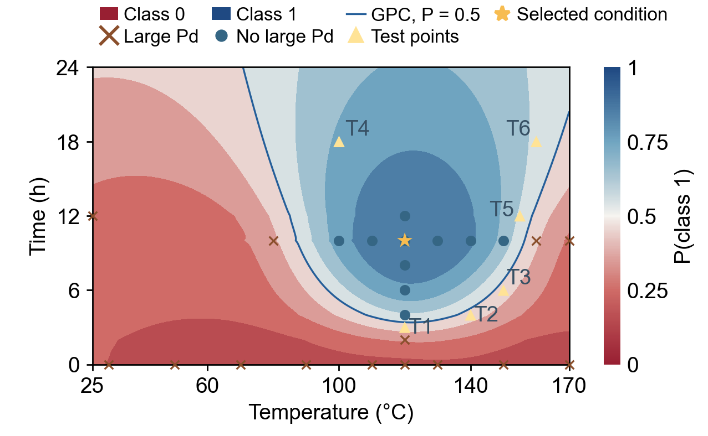

# Pd/MIL-101 Gaussian process classification

**Dataset `6.xlsx`, LogLoss-CV, before-stage ensemble of 50 models.** This repository contains the GPC component of panel c in `25_Panel_labels_8pt/Fig-3-4_Panel_labels_8pt.ai`.

## Run

Verified with Python 3.13.11. From the repository directory:

```sh
python -m venv .venv
# Windows PowerShell: .venv\Scripts\Activate.ps1
# Linux/macOS: source .venv/bin/activate
python -m pip install -r requirements.txt
python src/predict.py
python src/plot_probability.py
python src/validate.py
python src/verify_grid.py
```

Load joblib files only from trusted sources. Runtime paths are relative to this repository. Only standalone runnable code is distributed; legacy scripts with local paths and non-English strings have been omitted.



## Data and labels

`data/input_6_english.xlsx` is an English-header copy of the source `6.xlsx`, with identical numeric values and row order; `training.csv` contains its 24 unique conditions. The unified source identifies **16 experimental records and 8 interpolated zero-time conditions**. The `label_source` annotations are inherited from that source rule; this export does not independently audit every raw TEM experiment. The 120 °C / 0 h row is experimental according to the source annotation.

Features are temperature in °C and time in hours. Following SI Section S7.3, class 0 denotes obvious Pd particles exceeding 5 nm in the evaluated post-reduction TEM fields; class 1 denotes the absence of such particles. This is the manuscript-specific operational criterion, not a universal size threshold. These labels do not directly measure precursor motion or size, or independently establish ordering of all Pd species. Existing labels are preserved; this export does not re-label raw TEM images.

`manuscript_test.csv` holds T1–T6, with original point identifiers. These six conditions were not used in fitting the before-stage ensemble, but were already known: the evaluation is retrospective, not a prospective blind test. All six predictions match their saved labels; that does not establish general 100% accuracy. `original_eight_conditions_audit.csv` separately records the historical eight-condition list, including the 100 °C / 10 h training overlap.

## Training protocol

- 50 saved stratified outer splits, each with 18 training and 6 validation rows; each validation set has 3 rows per class. Splits overlap across runs.
- Experimental and interpolated rows can both enter validation. Scores are not experimental-only external-validation scores; interpolation-parent dependence cannot be excluded.
- Inner stratified three-fold CV minimizes pooled out-of-fold log loss; StandardScaler is fitted separately within each fold.
- Optuna TPE: 60 trials, 15 startup trials, saved seeds and an enqueued unit-parameter RBF trial.
- Kernels: constant × RBF, Matérn 1.5 or Matérn 2.5; variance 0.1–100 and standardized length scales 0.05–10, sampled on logarithmic scales.
- Laplace GPC with `optimizer=None`, `max_iter_predict=200`, `random_state=42`.
- Final probability is the equal-weight mean of all 50 outer-training models. Class threshold is 0.5. No single all-data model is substituted.

## Reproduction options

```sh
# Reconstruct from saved selected hyperparameters:
python src/train.py --mode fixed --output outputs/refit
python src/predict.py --models outputs/refit --output outputs/refit_predictions.csv
# Repeat 60-trial hyperparameter searches for all 50 splits:
python src/train.py --mode search --output outputs/full_search
# One-run check only:
python src/train.py --mode search --limit 1 --output outputs/search_check
```

The fixed route is not a repeat of model selection. Software/numerical versions may affect search reproducibility. Dependencies are pinned to the verified export environment.

At 120 °C / 10 h, direct ensemble probability is **0.8951074164949767**; interpolation in the displayed grid gives 0.8950916374377886. The six-point reference predictions and the full original grid are shipped. The map uses temperature horizontally and time vertically, the approved palette, the GPC P=0.5 contour, training conditions and T1–T6. The star denotes the manuscript-selected condition, not proof of a unique numerical optimum. Training times cover 0–12 h; the 12–24 h display region is extrapolation.

## Alignment with the Supporting Information

The primary before-addition model agrees with SI Section S7.3 and Supplementary Tables 14-16. The 16 experimental records comprise 15 unique temperature/time-series conditions plus the 25 °C / 12 h control; the shared 120 °C / 10 h condition is counted once. All seven holdout metrics match Table 15 at its reported precision, and all six test probabilities match Table 16. Outer seeds are 202601-202650 and inner seeds 203601-203650.

This repository covers the model used in main-text Figure 3c and the corresponding before-addition SI results. It does **not** reproduce the after-addition model in Supplementary Figure 72b/Table 17, or the dataset-6.1 sensitivity analysis. The manuscript-style plot uses the main-text marker scheme; SI Figure 72 distinguishes interpolated labels with separate symbols. That display difference does not change the model. See `SI_ALIGNMENT.md` for the checked scope and remaining distinctions.

Suggested code-availability wording: "Code, data and saved models for training, evaluating and plotting the primary pre-addition GPC ensemble are available at [repository URL], release [version]." The placeholders must be replaced after publication.

## Contents and verification

`src/`: training, prediction, plotting and checks. `data/`: inputs, fixed outer/inner splits and test conditions. `config/`: protocol, per-run parameters and palette. `models/frozen/`: 50 saved pipelines. `results/reference/`: search history, validation metrics, test predictions and grid. `results/figure/`: PNG/PDF/SVG GPC probability map. `provenance/`: source records. `validation/`: verification reports.

All 50 fixed-parameter reconstructions match the original predictions; all 58,081 probability grid points are checked. A complete 60-trial search for run 1 was verified in the preceding dataset-6 export and its report is retained; the full 50 searches were not rerun during export. This GPC-only package omits the phenomenological model, its equations, fit parameters and size curves, as well as its overlay in the original composite panel.

This package has not been uploaded to GitHub. Authors should choose a license and add verified author/citation information before release. No license is assigned on their behalf. Exclude `outputs/`, caches and environments when committing.
